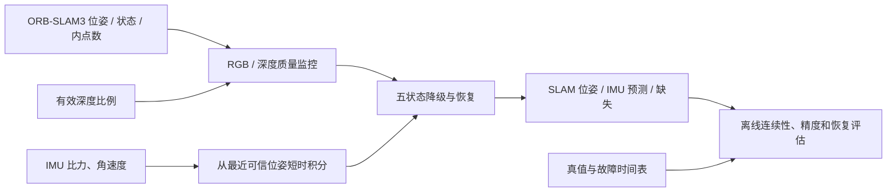

# E · 质量感知降级与恢复

本实验测试两件事：质量门限能否提前挡住异常位姿，以及短时惯性预测能补上多少输出。当前数据为可复现的合成控制日志，用于离线策略验证。TartanAir V2、ORB-SLAM3 实测和运行时接入仍待组内联调。

## 本地复现

需要 Python 3.10+。以下命令在仓库根目录执行。将生成的输入和新结果放在仓库外，方便对照仓库中的 `results/E/`。

```bash
python -m pip install -r experiments/E_adaptive_recovery/requirements.txt
python -m unittest discover -s experiments/E_adaptive_recovery -v
python experiments/E_adaptive_recovery/run.py --demo ../E-fixture --out ../E-replay
```

消融固定使用同一份输入。三类故障（RGB 低质量、深度失效、RGB 和深度共同中断）各跑种子 0、1、2。每份输入分别跑 `baseline`（原始 SLAM 输出）、`monitor`（质量监控）、`monitor_imu`（质量监控 + IMU 预测），共 27 组回放。合成相机帧率 10 Hz，IMU 100 Hz，每条 10 秒。真实日志到位后沿用同一策略矩阵，并使用组内选定的序列和故障表。

## A 日志接入

每次回放使用一个记录目录，所有时间戳以秒为单位、严格递增、基于同一时钟。

| 文件 | 内容 |
| --- | --- |
| `tracking.csv` | 每个计划相机帧一行，包含 `timestamp,valid,state,quality_rgb,quality_depth,source,latency_ms`。原始 SLAM 的有效帧标记 `source=slam`。丢帧和失跟也应保留时间戳行。可附 `rgb_inliers`。 |
| `trajectory_est.tum` | 有效 SLAM 估计，格式为 `timestamp tx ty tz qx qy qz qw`。 |
| `trajectory_gt.tum` | 同一格式，单独用于评估。以 15 ms 最近邻窗口配对，可在配置文件调整。 |
| `imu.csv` | `timestamp,gx,gy,gz,ax,ay,az`。陀螺仪单位 rad/s，加速度计比力单位 m/s²。允许缺省，届时预测不产生位姿。 |
| `faults.csv` | `fault,start_s,end_s`，表示故障区间 `[start_s,end_s)`。按时间排序、无重叠，无故障时保留表头。使用注入表中的真实传感器恢复时间。 |

RGB 质量和深度有效率为 0 到 1。可用 RGB 质量分数、内点数与跟踪状态会共同限制分数。全部 RGB 质量字段缺省时退回到跟踪状态，提前检测能力也随之受限。深度有效率缺省表示未知，整帧故障应显式给出 0。若需导出新字段，可在公共入口追加只读日志，由组内另走公共接口 PR。

输入位姿需表示本体到世界的变换，估计和真值使用相同的米制世界坐标。若 A 导出的是相机轨迹，先用标定外参转换为 IMU 本体轨迹。用三模态基线测试时，可在回放前按组内协议对真值应用一套固定 SE(3) 配准；估计和 IMU 重力方向继续使用基线世界系。三组策略复用这套配准。独立地图重置需由输入日志明确失跟并按有效共同坐标分段。

```bash
python experiments/E_adaptive_recovery/run.py --case ../recording --out ../E-real-results --dataset TartanAirV2 --sequence GROUP_SEQUENCE --fault rgb_depth_outage --seed 0 --revision BASELINE_COMMIT
```

## 方法与 PPT 第 4 页素材



| 状态 | 输出 |
| --- | --- |
| `NORMAL` | 可信 SLAM 位姿。 |
| `VISION_DEGRADED` | RGB 不可信且深度正常或未知，暂停位姿输出。 |
| `DEPTH_DEGRADED` | 深度不足时保留通过 RGB 和跟踪状态门限的基线位姿。 |
| `IMU_ONLY` | RGB 和深度同时不可信，允许在时限内输出标明来源与预测时长的惯性估计。 |
| `RECOVERY` | 连续可用的 SLAM 位姿通过一致性门限后恢复输出。等待期间允许继续短时惯性预测。 |

质量分数下跌即时生效，回升做指数平滑。最短保持时间约束恢复，质量急降可立即触发保护。恢复默认要求 3 个连续通过的观测，并与可用的 IMU 预测或前一候选位姿做平移、旋转一致性检查。这一检查只能提供局部一致性。默认预测时限为 2 秒，IMU 缺采样或无法得到初始速度时留空；时限本身只约束输出时长。阈值、门限、偏置、重力和允许时间差见 `config.json`，它们目前是开发默认值，正式测试前在开发序列上定稿。

本地预测器用最后两个可信位姿差分估速并对 IMU 比力积分。估速对位姿抖动敏感，预测年龄是记录的可信度线索。后续可在 `replay.py` 注入 D 的适配器，实现与本地预测器一致的 `accept(timestamp, pose)`、`break_velocity_history()` 和 `predict(timestamp)`（返回 `(pose, age_s)` 或 `(None, None)`），从组内接口获取可信速度/偏置。合成日志的真值不参与质量判断、积分和恢复控制。

## 结果与 PPT 第 9 页素材

- `results/E/policy_events.csv` 记录每帧的质量、状态、切换、位姿来源、预测时长和配对误差。原始跟踪日志与导出轨迹在 `runs/`，完整输入由 `--demo` 生成，哈希写入 `metrics.json`。
- `ablation.csv` 给出正常帧准确率、错误接管帧数、预测覆盖秒数、输出覆盖率、SLAM 覆盖率、ATE/RPE 与离线策略耗时。正常帧是故障区间外有配对真值的帧，准确要求距真值不超过 0.5 m 和 5°。错误接管指基线估计已在误差阈值内却输出 IMU 的帧。SLAM 原始失跟率单独统计。ATE 在共享世界系的配对有效帧计算，RPE 使用相邻配对有效帧。
- `recovery.csv` 从传感器故障结束计时，直到连续 3 帧发布的 SLAM 位姿达到误差阈值。未恢复的时间留空。深度单失效场景的 SLAM 可以持续正常，该场景记录的是观测恢复后确认所用时间。时长按帧区间统计，对日志缺口不外推。
- 两张汇报 PNG 位于 `figures/`。状态时间轴的浅色区域是故障注入窗口，使用种子 0。对照图展示种子 0/1/2 的均值和样本标准差。

**合成结果。**RGB 与深度共同中断 2.8 s 时，原始、只监控、监控加预测三组的输出覆盖率分别为 72.3%、70.3%、90.1%。加预测补齐 2.0 s，仍有空档。恢复确认从 0.2 s 延长到 0.4 s。预测组在 RGB 低质量场景恢复期还发生了每次 2 帧错误接管。

**失败案例。**共同中断的种子 2 在 IMU 比力中注入 0.55 m/s² 偏差，预测至 2 秒时平移误差约 0.76 m，超过 0.5 m 阈值。覆盖率的提升伴随预测漂移，正式实验需把覆盖率、误差和恢复时间一起报告。
